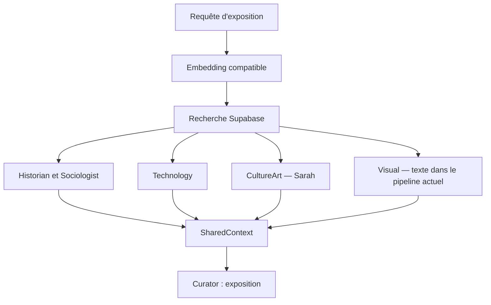

# Audit du ZIP fourni — AI Museum of the Future

Audit du code et des chemins d'exécution contenus dans l'archive du 13 octobre
2026. Les données Supabase, secrets n8n et comptes LLM ne sont pas accessibles
ici. Les résultats du rapport Week2-3 existant sont des résultats rapportés
par l'équipe, pas des résultats reproduits dans cet audit.

## L'idée du projet en une phrase

Construire une exposition pour un public futur, à partir de documents qui
représentent notre époque : actualité, recherche, pratiques culturelles et images.
Des spécialistes analysent les mêmes preuves puis un Curator rédige l'exposition.

Le mot « future » ne signifie pas que le système connaît les événements futurs.
Les hypothèses de futur doivent être présentées comme des hypothèses.

## Les cinq exigences de l'enseignant

| Exigence | Ce qu'elle signifie ici | État observable dans le ZIP |
|---|---|---|
| Automation | Un déclencheur n8n exécute le parcours utile | Export d'ingestion présent, chaîne vers les agents absente |
| Prompt engineering | Prompts versionnés, techniques, erreurs, itérations | Prompts présents ; ton prompt initial est v1 |
| RAG | Corpus, découpage, embeddings, recherche et évaluation | Modules présents, divergence Python/n8n à résoudre |
| Multi-agent | Plusieurs perspectives puis synthèse | Pipeline Python présent avec 5 spécialistes + Curator |
| Multimodal | Lire/générer une modalité non textuelle utile | Analyse d'image présente en isolation, pas raccordée au pipeline principal |

Le sujet n'impose pas d'entraîner un réseau neuronal pour chaque membre. Votre
travail porte surtout sur l'automatisation, les prompts, le RAG, les interactions
et l'évaluation. Un spécialiste qui appelle un LLM reste une brique à justifier ;
il ne faut pas prétendre qu'il possède une boucle autonome de planification et
d'exécution d'outils si cette boucle n'existe pas.

## Deux parcours distincts

### Préparer la base (ingestion)

Les collecteurs téléchargent des enregistrements. Les normaliseurs produisent
un format commun. Le chunker découpe le texte. Le modèle d'embeddings produit
un vecteur pour chaque morceau. Le store enregistre documents et chunks dans
Supabase. Cette étape modifie la base, et n'est pas nécessaire à chaque question.

### Utiliser la base (inférence)

Une question est vectorisée avec le modèle compatible avec les documents.
Supabase retourne les morceaux les plus proches. Les spécialistes analysent
les passages récupérés. SharedContext rassemble les contributions. Curator
produit titre, concept, quatre à six sections et éléments sélectionnés.

Les cinq spécialistes sont parallélisés dans agents/pipeline.py. La véritable
lecture d'images se trouve dans un module séparé, pas dans ce fan-out textuel.

## La configuration réellement incluse

- .env.example est vide : URL, clés et mots de passe ne sont pas fournis.
- Aucun .env privé n'est inclus.
- data/raw et data/processed ne contiennent pas le corpus, uniquement des
  emplacements .gitkeep dans l'archive reçue.
- Le workflow n8n référence des credentials PostgreSQL et HTTP, sans transporter
  leurs secrets. Une importation de JSON ne crée pas automatiquement ces accès.
- Des données épinglées pinData sont présentes. Une branche peut donc être
  alimentée par des résultats de développement plutôt que par un appel neuf.
- Le workflow exporté est inactif et commence par un déclencheur manuel.

Cela n'établit pas que votre Supabase est vide. Cela établit seulement qu'une
copie Git ne suffit pas à reconstituer votre environnement privé.

## Anomalies importantes, classées par conséquence

### A. Recherche incompatible entre Python et n8n

| Chemin | Modèle défini dans le code | Dimension | Découpage |
|---|---|---|---|
| Python | paraphrase-multilingual-MiniLM-L12-v2 | 384 | 512 tokens par défaut, 20 % overlap |
| n8n exporté | gemini-embedding-001 | 1536 | 2000 caractères, 300 caractères overlap |

Même si deux modèles produisent une dimension identique, leurs espaces ne
sont pas interchangeables. La dimension doit être vérifiée ET le modèle
d'ingestion confirmé. Une recherche Gemini utilise RETRIEVAL_QUERY ; le
workflow indexe les documents avec RETRIEVAL_DOCUMENT. Le nouvel adaptateur
conserve le modèle et la dimension définis dans ce workflow.

Le schéma rag/schema.sql déclare vector(384). Il ne suffit donc pas à recréer
une base correspondant aux embeddings du workflow exporté. Le type vector
de la fonction match_chunks doit également correspondre au chemin choisi.
Ne pas supprimer ou recréer les tables partagées pour « essayer ».

### B. Contraintes SQL manquantes dans le schéma versionné

- store.py utilise on_conflict="document_id,chunk_index" ; schema.sql ne crée
  pas de contrainte/index UNIQUE sur cette paire, seulement un index non unique
  sur document_id. L'upsert peut échouer sur une base créée avec ce seul SQL.
- Le nœud d'insertion documents de n8n utilise un conflit sur
  metadata->>'external_id'. L'index unique sur cette expression n'est pas défini
  dans schema.sql ; ce dernier définit source,source_id.
- Ces contraintes peuvent exister dans votre base live : l'archive ne permet
  pas de le confirmer. diagnostic_supabase.sql permet de les lire.

### C. Workflow n8n incomplet pour l'exposition

L'export possède 30 nœuds, majoritairement collection, routage, normalisation,
SQL, chunking et embedding. Il ne comporte pas d'appel aux six agents Python,
ni de recherche pilotée par une requête de visiteur, ni de synthèse Curator.

Défauts de raccordement visibles :
- Les sorties social_cultural et historical_context du premier Switch sont vides.
- normalize nasa n'est connecté à aucun nœud utile suivant.
- La sortie Wikimedia arrive à HTTP Request5, sans normalisation ni connexion
  vers l'insertion. Les branches Unsplash et gdelt_images n'ont pas de sortie.
- La condition Wikimedia compare à " wikimedia_commons" avec un espace initial,
  alors que la source configurée ne contient pas cet espace.
- HTTP Request5 utilise un paramètre "format " avec un espace final.
- Merge est configuré avec six entrées, mais les connexions alimentent les
  indices 0, 1, 3 et 4 seulement. Le comportement d'attente dépend du nœud et
  de la version n8n ; il faut tester la jonction, pas supposer six branches actives.
- Les références de credentials devront être remappées lors d'une importation.

Le nouveau CultureArtAgent_Sarah_template.json raccorde un webhook au backend
Python de Sarah. C'est un modèle de connexion pour un seul spécialiste, pas
la preuve que le workflow de l'équipe est déjà complet.

### D. Le dashboard n'exécute pas le vrai pipeline

app.py expose /, /api/data et /api/validate. /api/data lit uniquement les JSON
locaux. Il ne lit pas Supabase. /api/validate :
- découpe un petit texte construit dans la fonction ;
- vérifie que Retriever.retrieve existe, sans client Supabase ;
- construit trois faux InsightObject et teste leurs références communes ;
- vérifie que les fichiers de prompts existent ;
- considère le retour "Image unavailable." comme un test réussi de dégradation.

Ces contrôles sont utiles comme smoke checks. Ils ne sont pas une évaluation
de qualité du retrieval, une vraie analyse d'image ou une démonstration live.
Le JavaScript affiche des compteurs dérivés de ces contrôles ; le KPI « agents »
utilise le nombre de références communes, pas le nombre réel d'agents exécutés.
Dans populatePrompts, found dépend de la présence de l'entrée, pas de info.found.

### E. Agents et contrôles de sources

- Les spécialistes initiaux partagent un même squelette et varient surtout
  par leur rôle et leur prompt.
- BaseAgent._render_prompt concatène les contenus mais perd IDs et metadata.
  Cela empêche le modèle de connaître proprement les références attendues.
- CultureArt initial crée des findings génériques en remplacement d'une réponse
  incomplète. Ce n'est pas un constat étayé par les passages.
- Les autres spécialistes conservent ce comportement dans la copie corrigée :
  il faut harmoniser les contrôles en équipe, sans confondre ta contribution
  avec une réécriture de leurs agents.
- Curator filtre les références quand known_artifacts n'est pas vide. Quand
  cet ensemble est vide, ses conditions ne filtrent pas les IDs proposés.
- compute_cross_references incrémente pour chaque occurrence d'un ID. Deux
  répétitions dans le même agent peuvent donc être comptées comme un partage.
  Les tests de propriété génèrent des listes uniques ; ils ne couvrent pas ce cas.
  Ton agent déduplique désormais ses références.
- Le timeout divise timeout_secs par le nombre de spécialistes, et le contexte
  ThreadPoolExecutor attend les tâches à sa fermeture. Ce n'est pas un arrêt
  garanti à 120 secondes. Un test avec agents simulés ne prouve pas le délai live.

### F. Multimodalité et terminologie

analyze_image lit bien les octets d'une image et les envoie à un modèle vision.
Cependant :
- agents/visual.py ne l'appelle pas ; il analyse les chunks textuels comme les
  autres spécialistes.
- Les images et leurs descriptions ne sont pas automatiquement jointes aux
  chunks transmis au CultureArtAgent.
- Le champ clip_embedding contient un embedding MiniLM de la description,
  pas un vecteur CLIP calculé directement sur les pixels.
- Le data URL annonce toujours image/jpeg, même pour un fichier PNG.
- Les exceptions vision sont absorbées et donnent "Image unavailable." ; ce
  message seul ne distingue pas image absente, clé manquante et modèle indisponible.
- Le modèle vision par défaut est une valeur de configuration du dépôt ; sa
  disponibilité sur votre compte doit être vérifiée, pas présumée.

### G. Données et évaluation à consolider

- process_raw.clean_text supprime les retours à la ligne. Le chunking récursif
  a alors moins de structure de paragraphes à exploiter.
- Le chunk_size du mode fixed est en tokens si tiktoken existe ; celui du mode
  recursive est en caractères. Une comparaison avec la même valeur numérique
  ne constitue pas une comparaison équivalente.
- Le modèle MiniLM peut tronquer les textes longs selon sa limite d'entrée.
  Vérifier cette limite avant de retenir des chunks de 512 tokens tiktoken.
- La metadata du chunk Python ne conserve pas titre, URL et date. Les documents
  les ont, mais une jointure est nécessaire pour enrichir les preuves.
- GDELT est normalisé à partir du titre uniquement. Les scripts enrich_* écrivent
  full_text dans des sous-dossiers, que ingest_processed ne parcourt pas.
  process_global utilise aussi le titre ou la description, pas ces full_text.
- evaluate_data_quality écrit quality_report.json dans data/processed, le dossier
  globé par l'ingestion ; un rapport de qualité ne devrait pas être ingéré comme
  un document métier.
- process_global ne normalise pas les séries trends.
- fetch_all.run_module traite tout SystemExit comme un succès, même non nul.
- _parse_published_at ne reconnaît pas le format GDELT compact YYYYMMDD produit
  par normalize_gdelt. La date est alors conservée uniquement dans metadata.
- prompts/evaluate_prompts.py définit schema_valid par « c'est un dict », sans
  vérifier les quatre clés, les types ni la validité des références.
- input_tokens dans ce module est un compte de mots du contexte, pas le nombre
  de tokens réel du prompt complet.
- README agents/README.md décrit une fusion Socio-Historical et quatre experts,
  alors que pipeline.py crée cinq spécialistes. L'équipe doit aligner les docs.
- Le rapport Week2-3 mentionne OpenAI/GPT-4o et des vecteurs de 1536 dimensions ;
  le code Python actuel utilise un endpoint configurable Groq et MiniLM 384.
  Il faut actualiser les preuves du rapport avant la soutenance.

## Ce qui a été changé pour Sarah

1. CultureArtAgent conserve le contrat InsightObject et transmet les IDs et
   metadata au modèle. Il filtre les IDs inconnus et déduplique les listes.
2. Il s'abstient sans conclusion par défaut si aucune sortie exploitable n'est
   présente. L'InsightObject vide est reconnu comme manquant par le Curator.
3. Le prompt v1 est conservé ; le prompt v2 introduit exemples, citations,
   distinction faits/interprétation/hypothèse et abstention.
4. Le script standalone permet offline, fixture LLM, diagnostic puis live.
5. La recherche standalone choisit explicitement Gemini 1536 ou MiniLM 384,
   vérifie un échantillon et remonte les erreurs RPC au lieu de les masquer en [].
6. Un backend HTTP local et un modèle de workflow n8n rendent la contribution
   testable indépendamment du dashboard.
7. Des tests et un outil d'évaluation de prompts sont ajoutés, sans scores live
   pré-remplis. Le code original de collection, des autres agents et de n8n est
   conservé pour que l'équipe puisse revoir les écarts séparément.

## Limite importante de l'anti-hallucination

Vérifier que l'ID existe ne prouve pas que le passage soutient l'affirmation.
Le prompt demande une citation par finding, mais la version livrée ne valide
pas automatiquement ce format ni l'implication sémantique. Il faut lire les
passages et noter les affirmations non étayées. L'abstention sur données hors
domaine dépend également du jugement du modèle.

## Cartographie de tous les fichiers de code de l'archive

Les lignes suivantes donnent la responsabilité et les fonctions/classes de
chaque fichier Python de départ, puis les fichiers web, SQL, prompts et n8n.
Cette cartographie explique leur place dans le projet ; elle ne certifie pas
la qualité live de chaque API externe.

### `agents/__init__.py`

Initialisation du package ; exports des classes si présents.

### `agents/base_agent.py`

Contrat InsightObject, appel chat JSON et lecture/rendu du prompt partagé.

Blocs principaux : `InsightObject`, `BaseAgent`.

### `agents/culture_art.py`

Spécialiste initial des arts/culture ; modifié dans la livraison de Sarah.

Blocs principaux : `CultureArtAgent`.

### `agents/curator.py`

Synthèse des perspectives, validation de 4-6 sections et retry avec feedback.

Blocs principaux : `CuratorValidationError`, `SectionObject`, `ExhibitionSynthesis`, `_is_empty`, `CuratorAgent`.

### `agents/historian.py`

Spécialiste des événements et de leur signification historique.

Blocs principaux : `HistorianAgent`.

### `agents/llm_config.py`

Lit modèle, URL et clé du fournisseur compatible OpenAI ; construit le client.

Blocs principaux : `get_model`, `get_vision_model`, `build_llm_client`.

### `agents/pipeline.py`

Construit les spécialistes, parallélise leurs appels, transmet au Curator.

Blocs principaux : `_build_specialist_agents`, `run_pipeline`.

### `agents/shared_context.py`

Agrège les résultats et calcule les références communes.

Blocs principaux : `SharedContext`, `compute_cross_references`.

### `agents/sociologist.py`

Spécialiste des tendances sociales et comportements.

Blocs principaux : `SociologistAgent`.

### `agents/technology.py`

Spécialiste recherche, innovations et technologies.

Blocs principaux : `TechnologyAgent`.

### `agents/visual.py`

Spécialiste textuel des aspects visuels ; ne lit pas directement des images.

Blocs principaux : `VisualAgent`.

### `app.py`

Dashboard Flask et smoke checks locaux, sans génération réelle d’exposition.

Blocs principaux : `create_app`.

### `data/__init__.py`

Initialisation du package ; exports des classes si présents.

### `data/fetch_all.py`

Orchestre collecteurs data/, normalisation et ingestion Python.

Blocs principaux : `_run_ingestion`, `run_module`, `main`.

### `data/fetch_arxiv.py`

Collecte résumés scientifiques via requêtes thématiques arXiv.

Blocs principaux : `fetch_papers`, `save`.

### `data/fetch_gdelt.py`

Collecte titres/metadata de presse par langue et pays.

Blocs principaux : `build_params`, `fetch_articles`, `save`, `fetch_by_languages`, `fetch_by_countries`.

### `data/fetch_wikimedia.py`

Collecte liens et descriptions de médias Wikimedia.

Blocs principaux : `search_images`, `save`.

### `data/fetch_wikipedia.py`

Collecte pageviews, résumés et résultats Wikidata SPARQL.

Blocs principaux : `fetch_pageviews_top`, `fetch_article_summary`, `fetch_wikidata`, `save`.

### `data/fetch_worldbank.py`

Collecte des indicateurs World Bank, pagination et filtrage pays.

Blocs principaux : `fetch_indicator`, `main`.

### `data/ingest.py`

Lit JSON locaux, upsert documents, chunking, embeddings, upsert chunks et rapport.

Blocs principaux : `_retry`, `IngestionReport`, `ingest_processed`.

### `data/process_global.py`

Normalisation des fichiers des collecteurs scripts/ au schéma commun.

Blocs principaux : `_as_text`, `_as_tags`, `normalize_openverse`, `normalize_met`, `normalize_archive`, `normalize_dbpedia`, `normalize_arxiv_global`, `process_dir`, `process_arxiv_global`.

### `data/process_raw.py`

Nettoyage HTML, IDs stables, normalisation par source, déduplication.

Blocs principaux : `clean_text`, `stable_id`, `dedup`, `normalize_gdelt`, `normalize_wikimedia`, `normalize_arxiv`, `normalize_wikipedia_pageviews`, `normalize_wikipedia_summary`, `normalize_wikidata`, `normalize_worldbank`, `get_normalizer`, `process_file`.

### `data/regions.py`

Listes de langues et pays pour diversifier les requêtes.

### `data/topics.py`

Liste partagée de thèmes par perspective et thèmes événementiels.

### `demo_multimodal.py`

Démonstration indépendante du modèle vision sur une image locale.

Blocs principaux : `pick_image`, `main`.

### `demo_retrieval.py`

Démonstration live Python MiniLM -> Supabase sur cinq requêtes.

Blocs principaux : `main`.

### `multimodal/__init__.py`

Initialisation du package ; exports des classes si présents.

### `multimodal/analyze_image.py`

Télécharge/lit une image, appelle vision et vectorise sa description textuelle.

Blocs principaux : `VisualDescription`, `analyze_image`.

### `prompts/__init__.py`

Initialisation du package ; exports des classes si présents.

### `prompts/evaluate_prompts.py`

Essais de prompts, contrôle JSON faible et journal des erreurs.

Blocs principaux : `EvalRecord`, `_load_prompt`, `evaluate_all`.

### `rag/chunking/__init__.py`

Initialisation du package ; exports des classes si présents.

### `rag/chunking/chunker.py`

Fenêtre fixe et découpage récursif avec overlap et metadata de stratégie.

Blocs principaux : `ChunkingStrategy`, `ChunkConfig`, `Chunk`, `_get_encoding`, `_last_sentence`, `Chunker`.

### `rag/vector_store/__init__.py`

Initialisation du package ; exports des classes si présents.

### `rag/vector_store/embedder.py`

Vectorisation de chaque chunk avec retries et journal des échecs.

Blocs principaux : `embed_chunks`.

### `rag/vector_store/local_embeddings.py`

Adaptateur fastembed local MiniLM avec interface embeddings OpenAI.

Blocs principaux : `_get_model`, `_Embeddings`, `LocalEmbeddingClient`, `build_embedding_client`.

### `rag/vector_store/retriever.py`

Embedding de requête, RPC match_chunks, filtres et reranking optionnel.

Blocs principaux : `RetrievalResult`, `Retriever`.

### `rag/vector_store/store.py`

Conversion des dates et upserts des documents/chunks Supabase.

Blocs principaux : `_parse_published_at`, `upsert_document`, `upsert_chunks`.

### `scripts/config.py`

Chargement de .env pour scripts de collecte et ingestion.

### `scripts/download_gdelt_images.py`

Extrait og:image/twitter:image des articles et télécharge les photos.

Blocs principaux : `find_og_image`, `guess_extension`, `download_image`, `main`.

### `scripts/download_images.py`

Télécharge les octets des images Openverse/Met.

Blocs principaux : `guess_extension`, `download_one`, `download_openverse`, `download_met`, `main`.

### `scripts/enrich_archive_text.py`

Téléchargement de fichiers OCR/DjVuTXT pour enrichir les textes Archive.

Blocs principaux : `get_text_file_url`, `fetch_text`, `main`.

### `scripts/enrich_gdelt_text.py`

Extraction des articles complets via trafilatura dans un sous-dossier.

Blocs principaux : `extract_one`, `main`.

### `scripts/evaluate_data_quality.py`

Statistiques de qualité et diversité des données brutes ; pas une évaluation retrieval.

Blocs principaux : `load_json_files`, `eval_arxiv`, `eval_gdelt`, `eval_met`, `eval_openverse`, `eval_dbpedia`, `eval_archive`, `eval_trends`, `main`.

### `scripts/fetch_archive.py`

Collecte metadata de textes, audio et vidéo Internet Archive.

Blocs principaux : `fetch_term`, `main`.

### `scripts/fetch_arxiv.py`

Collecte arXiv globale avec une requête combinant des catégories.

Blocs principaux : `fetch_combined`, `parse_entries`, `main`.

### `scripts/fetch_dbpedia.py`

Collecte labels, catégories et liens DBpedia, fallback si résumé absent.

Blocs principaux : `get_english_value`, `fetch_entity`, `main`.

### `scripts/fetch_gdelt.py`

Collecte GDELT globale par thème avec langues et retries.

Blocs principaux : `build_query`, `fetch_topic`, `main`.

### `scripts/fetch_met.py`

Collecte d’objets Met Museum et filtre de pertinence géographique/culturelle.

Blocs principaux : `get_json`, `is_actually_relevant`, `fetch_term`, `main`.

### `scripts/fetch_openverse.py`

Collecte d’images et licences par pays/thèmes.

Blocs principaux : `fetch_term`, `main`.

### `scripts/fetch_trends.py`

Collecte séries temporelles de couverture médiatique GDELT.

Blocs principaux : `fetch_timeline`, `main`.

### `test_agents_live.py`

Essai LLM des spécialistes et Curator sur des chunks construits dans le script.

Blocs principaux : `sep`, `print_insight`.

### `tests/__init__.py`

Tests automatisés : 

### `tests/agents/__init__.py`

Tests automatisés : 

### `tests/agents/test_agent_pipeline.py`

Tests automatisés : test_cross_references_correctness, test_specialist_agent_output_structure_and_grounding, test_specialist_agent_returns_populated_insight_object, test_specialist_agent_malformed_llm_response_raises, test_specialist_agent_llm_response_with_missing_fields_uses_defaults, test_curator_synthesis_structure, test_run_pipeline_completes_within_120_seconds, test_run_pipeline_cross_references_shared_artifacts, test_run_pipeline_resilient_when_one_agent_fails, test_run_pipeline_resilient_when_two_agents_fail

Blocs principaux : `insight_object_strategy`, `test_cross_references_correctness`, `retrieval_result_strategy`, `_make_mock_llm_response`, `test_specialist_agent_output_structure_and_grounding`, `test_specialist_agent_returns_populated_insight_object`, `test_specialist_agent_malformed_llm_response_raises`, `test_specialist_agent_llm_response_with_missing_fields_uses_defaults`, `shared_context_strategy`, `_make_valid_curator_payload`, `test_curator_synthesis_structure`, `_make_insight`, `_patch_all_specialists`, `test_run_pipeline_completes_within_120_seconds`, `test_run_pipeline_cross_references_shared_artifacts`, `test_run_pipeline_resilient_when_one_agent_fails`, `test_run_pipeline_resilient_when_two_agents_fail`.

### `tests/agents/test_curator_improvements.py`

Tests automatisés : test_retries_with_feedback_after_bad_section_count, test_raises_after_exhausting_attempts, test_invented_artifacts_are_dropped_and_fall_back_to_cross_refs, test_failed_specialists_are_reported_and_told_to_the_model, test_changelog_header_is_not_sent_to_the_model

Blocs principaux : `_payload`, `_ctx`, `test_retries_with_feedback_after_bad_section_count`, `test_raises_after_exhausting_attempts`, `test_invented_artifacts_are_dropped_and_fall_back_to_cross_refs`, `test_failed_specialists_are_reported_and_told_to_the_model`, `test_changelog_header_is_not_sent_to_the_model`.

### `tests/data/__init__.py`

Tests automatisés : 

### `tests/data/test_ingest.py`

Tests automatisés : test_report_has_correct_document_count, test_report_total_chunks_stored, test_report_chunks_by_strategy, test_report_skipped_chunks_zero_when_no_errors, test_report_returns_ingestion_report_instance, test_empty_directory_returns_zero_counts, test_multiple_json_files_are_all_processed, test_chunker_exception_skips_record_but_continues, test_skip_ingest_prevents_ingestion, test_without_skip_ingest_ingestion_is_called, test_skip_ingest_with_skip_process_also_skips

Blocs principaux : `_fake_upsert_document`, `_fake_upsert_chunks`, `_patched_store`, `_make_records`, `_FakeChunk`, `_FakeChunker`, `TestIngestProcessed`, `TestSkipIngestFlag`.

### `tests/data/test_process_raw.py`

Tests automatisés : test_processed_record_schema_completeness, test_normalizer_deduplication, test_known_raw_dict_produces_expected_fields, test_missing_url_generates_stable_id, test_html_in_title_is_stripped, test_known_raw_dict_produces_expected_fields, test_missing_url_generates_stable_id, test_thumb_url_used_as_image_url_when_present, test_known_raw_dict_produces_expected_fields, test_date_truncated_to_10_chars, test_known_raw_dict_produces_expected_fields, test_id_is_stable_hash, test_known_raw_dict_produces_expected_fields, test_missing_page_id_falls_back_to_stable_id, test_known_raw_dict_with_person_produces_expected_fields, test_wikidata_tags_exclude_http_values, test_gdelt_record_with_empty_title_and_text_is_dropped, test_arxiv_record_with_empty_title_and_summary_is_dropped, test_malformed_json_returns_empty_list, test_unknown_source_prefix_returns_empty_list, test_valid_arxiv_record_is_returned, test_duplicate_ids_are_deduplicated_by_process_file, test_non_dict_items_in_list_are_skipped

Blocs principaux : `gdelt_record`, `wikimedia_record`, `arxiv_record`, `wikipedia_record`, `_normalize_wikipedia_dispatch`, `_apply_normalizer`, `test_processed_record_schema_completeness`, `raw_records_with_duplicate_ids`, `test_normalizer_deduplication`, `TestNormalizeGdelt`, `TestNormalizeWikimedia`, `TestNormalizeArxiv`, `TestNormalizeWikipediaPageviews`, `TestNormalizeWikipediaSummary`, `TestNormalizeWikidata`, `TestProcessFileFiltering`.

### `tests/data/test_worldbank.py`

Tests automatisés : test_environmental_indicator_uses_active_world_bank_series, test_fetch_indicator_paginates_and_filters_to_covered_countries, test_worldbank_record_normalizes_to_statistics_document

Blocs principaux : `test_environmental_indicator_uses_active_world_bank_series`, `test_fetch_indicator_paginates_and_filters_to_covered_countries`, `test_worldbank_record_normalizes_to_statistics_document`.

### `tests/multimodal/__init__.py`

Tests automatisés : 

### `tests/multimodal/test_analyze_image.py`

Tests automatisés : test_property12_visual_description_structure_completeness, test_property13_vision_graceful_degradation, test_wikimedia_url_1_description_non_empty, test_wikimedia_url_2_description_non_empty, test_wikimedia_url_3_description_non_empty, test_wikimedia_url_4_description_non_empty, test_wikimedia_url_5_description_non_empty, test_returns_within_10_seconds, test_non_200_response_returns_degradation, test_nonexistent_file_path_returns_degradation, test_return_type_is_visual_description, test_no_api_key_and_no_client_returns_degradation

Blocs principaux : `_fake_embedding_client`, `_no_real_embedding_model`, `_make_openai_client`, `_make_requests_get_ok`, `test_property12_visual_description_structure_completeness`, `test_property13_vision_graceful_degradation`, `TestAnalyzeImageUnit`.

### `tests/prompts/__init__.py`

Tests automatisés : 

### `tests/prompts/test_evaluate_prompts.py`

Tests automatisés : test_valid_json_schema_valid_true, test_curator_valid_json, test_invalid_json_string_schema_valid_false, test_json_list_not_dict_schema_valid_false, test_empty_string_response_schema_valid_false, test_fail_logged_on_invalid_json, test_fail_logged_on_api_exception, test_fail_reason_contains_excerpt_on_non_json, test_schema_valid_is_always_bool, test_fail_reason_is_none_when_valid, test_fail_reason_is_str_when_invalid, test_prompt_version_extracted, test_multiple_agents_returns_one_record_each, test_mixed_valid_invalid_responses, test_three_fixture_sets

Blocs principaux : `_make_openai_response`, `_valid_specialist_payload`, `_valid_curator_payload`, `_make_client_returning`, `TestHappyPathSpecialistAgents`, `TestInvalidJsonResponse`, `TestFailLogging`, `TestEvalRecordFieldTypes`, `TestBatchEvaluation`, `TestThreeChunkFixturesPerAgent`.

### `tests/rag/__init__.py`

Tests automatisés : 

### `tests/rag/test_chunker.py`

Tests automatisés : test_chunker_fixed_size_non_empty_output, test_chunker_recursive_non_empty_output, test_fixed_size_overlap_invariant, test_chunk_metadata_inheritance_fixed_size, test_chunk_metadata_inheritance_recursive, test_fixed_size_single_sentence_yields_one_chunk, test_recursive_single_sentence_yields_one_chunk, test_text_exactly_at_boundary_produces_one_chunk, test_text_one_token_over_boundary_produces_two_chunks, test_overlap_meets_minimum_token_count, test_overlap_content_appears_in_consecutive_chunks

Blocs principaux : `test_chunker_fixed_size_non_empty_output`, `test_chunker_recursive_non_empty_output`, `test_fixed_size_overlap_invariant`, `processed_record_strategy`, `test_chunk_metadata_inheritance_fixed_size`, `test_chunk_metadata_inheritance_recursive`, `_make_record`, `_encoder`, `TestSingleSentence`, `TestChunkSizeBoundary`, `TestOverlapMinimumTokenCount`.

### `tests/rag/test_embedder.py`

Tests automatisés : test_returns_same_count_as_input, test_pairs_contain_original_chunk_and_vector, test_embeddings_create_called_once_per_chunk, test_empty_input_returns_empty_list, test_chunk_included_after_retry_success, test_embeddings_create_called_twice_on_one_failure, test_retry_succeeds_on_last_allowed_attempt, test_chunk_excluded_when_all_retries_fail, test_skip_message_printed_when_all_retries_fail, test_create_called_exactly_max_retries_times, test_successful_chunks_preserved_when_one_fails, test_returns_uuid_from_response, test_upsert_called_on_documents_table, test_returns_empty_string_when_response_data_is_empty, test_record_fields_passed_to_upsert, test_returns_written_count, test_returns_zero_for_empty_input, test_upsert_called_on_chunks_table, test_rows_contain_document_uuid, test_rows_contain_chunk_content_and_embedding

Blocs principaux : `_make_chunk`, `_fake_embedding`, `_mock_openai_client`, `TestEmbedChunksHappyPath`, `TestEmbedChunksRetry`, `TestEmbedChunksAllRetriesFail`, `TestUpsertDocument`, `TestUpsertChunks`.

### `tests/rag/test_local_embeddings.py`

Tests automatisés : test_client_mimics_openai_embeddings_interface, test_schema_dimension_matches_embedding_model

Blocs principaux : `test_client_mimics_openai_embeddings_interface`, `test_schema_dimension_matches_embedding_model`.

### `tests/rag/test_retriever.py`

Tests automatisés : test_property6_similarity_score_range_and_ordering, test_property7_retriever_filter_correctness, test_property8_reranker_count_preservation, test_fields_set_correctly, test_defaults, test_default_match_count, test_custom_match_count, test_clients_stored, test_returns_list_of_retrieval_results, test_sorted_descending_similarity, test_similarity_clamped_to_unit_interval, test_match_count_limits_output, test_empty_query_returns_empty_list, test_none_supabase_returns_empty_list, test_embed_query_called_with_model, test_rpc_called_with_embedding_and_match_count, test_filter_forwarded_to_rpc, test_no_filter_arg_omitted_from_rpc, test_alternative_field_names, test_non_dict_rows_skipped, test_warning_logged_when_fewer_than_100_chunks, test_no_warning_when_100_or_more_chunks, test_retrieval_continues_despite_low_chunk_count, test_no_crash_when_count_query_fails, test_rerank_true_calls_configured_model, test_rerank_reorders_by_score_descending, test_rerank_preserves_count, test_rerank_false_skips_llm_call, test_rerank_falls_back_on_llm_error, test_rerank_falls_back_on_empty_json_scores, test_rerank_scores_clamped_to_unit_interval, test_rerank_with_no_openai_client_returns_original, test_rerank_with_empty_results_returns_empty, test_query_ai_breakthroughs_2023, test_query_climate_change_social_impact, test_query_contemporary_art_arab_world, test_query_pandemic_global_health_response, test_query_space_exploration_milestones, test_museum_domain_low_chunk_warning_logs_but_continues

Blocs principaux : `_make_openai_client`, `_make_rpc_row`, `_make_supabase_client`, `TestRetrievalResult`, `TestRetrieverInit`, `TestRetrieverRetrieve`, `TestRetrieverFilter`, `TestRetrieverRowNormalisation`, `TestRetrieverChunkCountWarning`, `_make_reranker_client`, `TestReranker`, `test_property6_similarity_score_range_and_ordering`, `_make_supabase_client_with_category_filter`, `test_property7_retriever_filter_correctness`, `retrieval_result_strategy`, `_make_reranker_client_for_results`, `test_property8_reranker_count_preservation`, `TestMuseumDomainQueries`.

### `tests/test_app.py`

Tests automatisés : test_dashboard_serves_assets_and_favicon, test_validation_api_returns_steps

Blocs principaux : `test_dashboard_serves_assets_and_favicon`, `test_validation_api_returns_steps`.

### `tests/test_core_api.py`

Tests automatisés : test_cross_references_are_detected, test_retriever_returns_sorted_results, test_analyze_image_returns_description_for_mocked_content

Blocs principaux : `DummyEmbeddings`, `DummyChat`, `DummySupabase`, `test_cross_references_are_detected`, `test_retriever_returns_sorted_results`, `test_analyze_image_returns_description_for_mocked_content`.

### `tests/test_pipeline_e2e.py`

Tests automatisés : test_ingest_processed_fixture_corpus, test_retriever_retrieve_returns_results, test_run_pipeline_with_mock_agents, test_analyze_image_wikimedia_url

Blocs principaux : `_make_fixture_records`, `test_ingest_processed_fixture_corpus`, `test_retriever_retrieve_returns_results`, `test_run_pipeline_with_mock_agents`, `test_analyze_image_wikimedia_url`.

## Fichiers non Python

| Fichier | Responsabilité |
|---|---|
| `.env.example` | Noms des variables de configuration ; valeurs vides. |
| `.gitignore` | Exclut secrets, environnement, caches et données locales du dépôt. |
| `README.md` | Documentation du dossier ou spécification du corpus. |
| `agents/README.md` | Documentation du dossier ou spécification du corpus. |
| `data/DATA_SOURCES.md` | Documentation du dossier ou spécification du corpus. |
| `data/README.md` | Documentation du dossier ou spécification du corpus. |
| `data/processed/.gitkeep` | Conserve un dossier vide dans Git, sans corpus. |
| `data/raw/.gitkeep` | Conserve un dossier vide dans Git, sans corpus. |
| `docs/812254868_1128070259647648_1571835780547333349_n.png` | Schéma d’architecture illustratif ; comparer au pipeline exécuté. |
| `docs/AI_Museum_of_the_Future_W1.pdf` | Consignes/rapports historiques ; actualiser les affirmations avec la version actuelle. |
| `docs/Advanced DL-Exam.pdf` | Consignes/rapports historiques ; actualiser les affirmations avec la version actuelle. |
| `docs/Week2-3_Validation_Report.pdf` | Consignes/rapports historiques ; actualiser les affirmations avec la version actuelle. |
| `docs/data_collection_spec.md` | Documentation du dossier ou spécification du corpus. |
| `multimodal/README.md` | Documentation du dossier ou spécification du corpus. |
| `multimodal/images/.gitkeep` | Conserve un dossier vide dans Git, sans corpus. |
| `n8n/.gitkeep` | Conserve un dossier vide dans Git, sans corpus. |
| `n8n/README.md` | Documentation du dossier ou spécification du corpus. |
| `n8n/workflows/My workflow.json` | Export n8n d’ingestion, avec credentials référencés et résultats épinglés. |
| `prompts/README.md` | Documentation du dossier ou spécification du corpus. |
| `prompts/culture_art.md` | Instructions LLM de culture_art ; version et format attendus. |
| `prompts/curator.md` | Instructions LLM de curator ; version et format attendus. |
| `prompts/historian.md` | Instructions LLM de historian ; version et format attendus. |
| `prompts/sociologist.md` | Instructions LLM de sociologist ; version et format attendus. |
| `prompts/system.md` | Instructions LLM de system ; version et format attendus. |
| `prompts/technology.md` | Instructions LLM de technology ; version et format attendus. |
| `prompts/visual.md` | Instructions LLM de visual ; version et format attendus. |
| `pytest.ini` | Configure tests/ comme dossier de tests. |
| `rag/README.md` | Documentation du dossier ou spécification du corpus. |
| `rag/chunking/.gitkeep` | Conserve un dossier vide dans Git, sans corpus. |
| `rag/schema.sql` | Schéma Postgres/pgvector et fonction de recherche, configuration 384. |
| `rag/vector_store/.gitkeep` | Conserve un dossier vide dans Git, sans corpus. |
| `requirements.txt` | Dépendances Python du projet complet. |
| `scripts/.gitkeep` | Conserve un dossier vide dans Git, sans corpus. |
| `web/app.js` | Navigation, appels /api/validate et /api/data, filtres/pagination/modal. |
| `web/index.html` | Structure HTML du dashboard : navigation, contrôles et explorateur. |
| `web/styles.css` | Présentation CSS du dashboard. |

## Nœuds n8n, un par un

| Nom | Type | Destinations raccordées |
|---|---|---|
| When clicking ‘Execute workflow’ | manualTrigger | config sources  |
| HTTP Request | httpRequest | XML |
| XML | xml | normalize |
| normalize | code | Merge |
| Execute a SQL query | postgres | chunk |
| chunk | code | HTTP Request1 |
| HTTP Request1 | httpRequest | format embedding |
| format embedding | code | Execute a SQL query1 |
| Execute a SQL query1 | postgres | Aucune |
| config sources  | code | Switch |
| Switch | switch | Switch2, Switch3, Switch1 |
| Switch1 | switch | HTTP Request nasa api, expand queries, HTTP Request open data |
| expand queries | code | HTTP Request |
| HTTP Request nasa api | httpRequest | normalize nasa |
| normalize nasa | code | Aucune |
| HTTP Request open data | httpRequest | Code in JavaScript |
| Code in JavaScript | code | Merge |
| Switch2 | switch | HTTP Request2, HTTP Request3, HTTP Request4 |
| HTTP Request2 | httpRequest | gdelt normalize |
| HTTP Request3 | httpRequest | normalize news api |
| gdelt normalize | code | Aucune |
| HTTP Request4 | httpRequest | XML1 |
| XML1 | xml | Code in JavaScript1 |
| normalize news api | code | Merge |
| Code in JavaScript1 | code | Merge |
| Switch3 | switch | HTTP Request5 |
| HTTP Request5 | httpRequest | Aucune |
| Merge | merge | get existing docs |
| get existing docs | postgres | dedup docs |
| dedup docs | code | Execute a SQL query |
